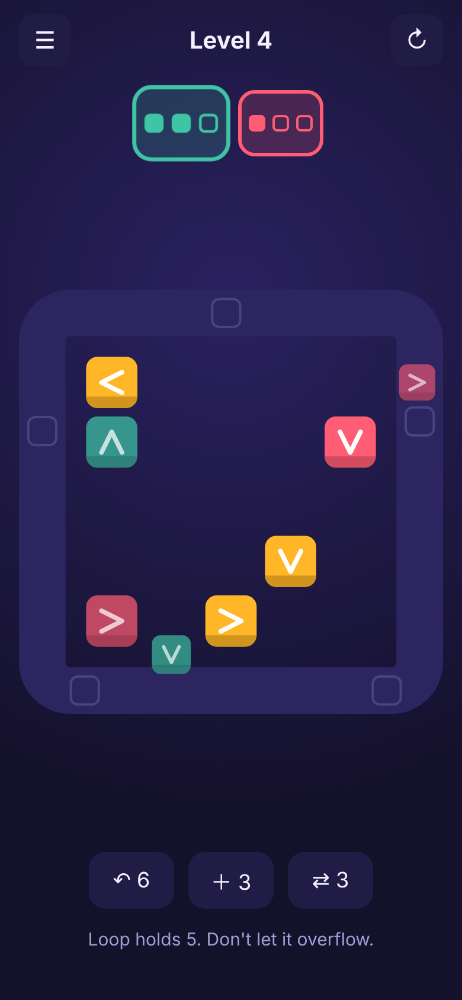
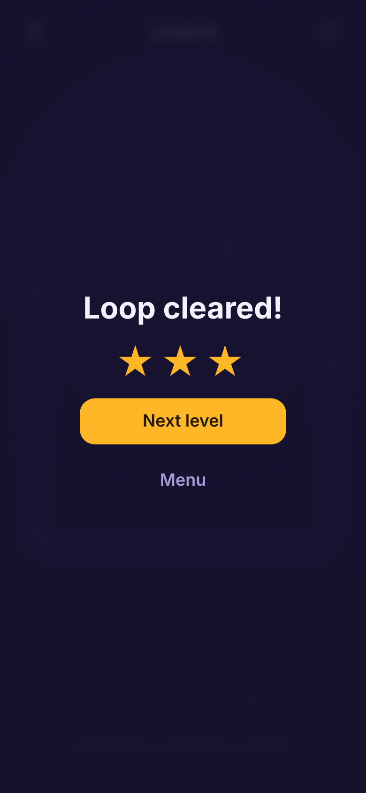

# Loopline

**Arrow escape meets conveyor sort, on a ring.** Free the arrows, feed the loop, don't let it overflow.

<p>
  
  
  
</p>

A mobile web puzzle game (PWA, portrait, offline) in plain JavaScript, with no build and no runtime dependencies. Every level comes from a seed and a solver proves it solvable before you see it.

## How to play

- Tap a tile whose arrow has a clear path: it slides out onto the loop around the board
- Bins at the top pull tiles of their color; three of a color clear a bin and the next color takes its place
- The loop holds only a few tiles: overflow it and you lose
- Numbered tiles stay locked until that many moves have passed
- Clear the board and the loop to win; the fewer tiles you park on the loop, the more stars you get
- Stars earn boosters: undo, an extra loop slot, and reversing the order of the colors to come
- **Daily Loop**: the same level for everyone each UTC day, a streak, and an emoji summary to share

## How to run

```sh
npm install
npm run serve   # http://localhost:5173
```

| Command         | What it does                                                                                      |
| --------------- | ------------------------------------------------------------------------------------------------- |
| `npm test`      | Rules, solver, difficulty curve, boosters, daily and PWA tests (`node:test`)                      |
| `npm run check` | Biome lint and format check                                                                       |
| `npm run e2e`   | Plays levels 1–4 and the Daily Loop by touch in Chromium, checks progress, offline reload and axe |

## Layout

- `src/core/` pure, deterministic game logic: rules, seeded generator, solver, levels, daily
- `src/ui/` canvas board, sound and haptics, saved progress
- `src/main.js` screens and input wiring; `sw.js` offline cache

## More

- [Concept and market read](docs/concept.md)
- [Backlog](BACKLOG.md)
