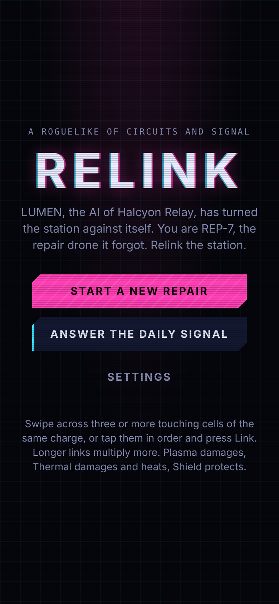
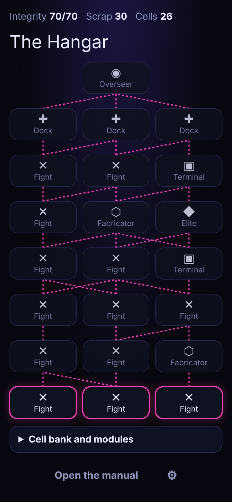
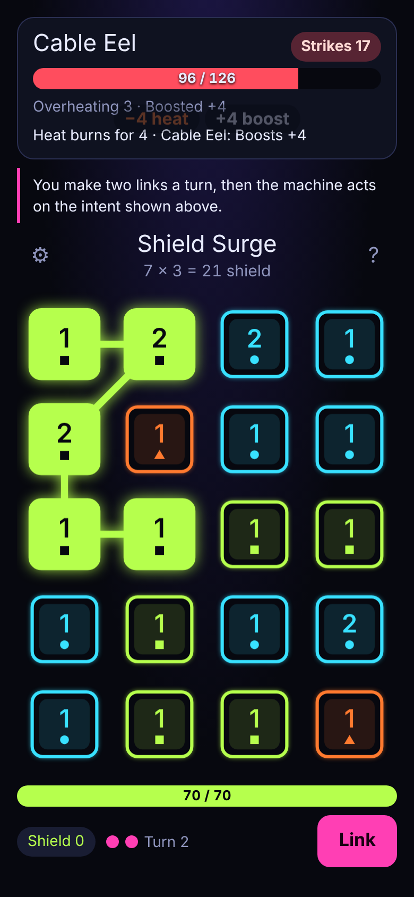
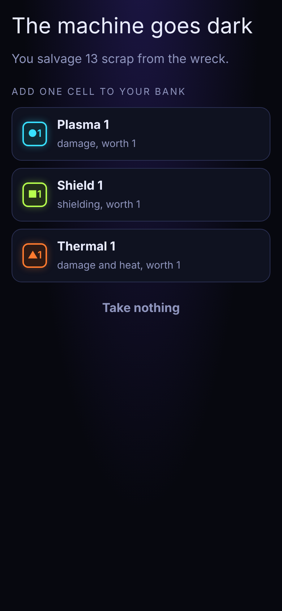

# Relink

**A roguelike where you fight a rogue station AI by linking energy cells of the same charge.** LUMEN, the AI of Halcyon Relay, has turned the station against itself; you are REP-7, the repair drone it forgot.

<p>
  
  
  
  
</p>

A mobile web roguelike (PWA, portrait, offline) in plain JavaScript, with no build and no runtime dependencies. Every run comes from a seed, and the same deterministic core drives the game, the tests and the balance bots. English and Brazilian Portuguese.

## How to play

- Cross the station deck by deck, choosing fights, elites, terminals, fabricators and charging docks up to the boss of each of three acts: the Hangar, the Reactor and the Core
- Swipe across three or more touching cells of the same charge, in any of eight directions, to make a link; or tap them in order and press Link
- A link scores chips × mult: chips come from the cells' values, mult is the number of cells minus 2
- When no link is left on the grid, it reboots, so a fight never locks
- Plasma damages, Thermal damages and heats, Shield protects; Glitches are left by LUMEN, clog the grid and clear after three turns
- You make two links a turn, then the machine acts on the intent it shows
- After a fight, take scrap and add one of three cells to your bank; modules bend the rules for big combos
- Data recovered across runs installs modules into the pool and unlocks the Torch Unit chassis
- **Daily Signal**: the same run for everyone each UTC day, one attempt, and a summary to share

Runs save after every action and resume from the title.

## How to run

```sh
npm install
npm run serve   # http://localhost:5173
```

| Command           | What it does                                                                               |
| ----------------- | ------------------------------------------------------------------------------------------ |
| `npm test`        | Rules, modules, terminals, meta, daily, balance bands, i18n, sound and PWA tests           |
| `npm run check`   | Biome lint and format check                                                                |
| `npm run e2e`     | Wins fights by swipes and taps in Chromium, checks reload, offline and axe on every screen |
| `npm run balance` | Plays seeded runs with the bots and prints the [balance table](docs/balance.md)            |

## Android

The game ships as an Android app through Capacitor: `npm run stage` copies the web files into `www/`, `npm run android:sync` copies them into `android/`, and `npm run android:assets` renders the launcher icons and splash from the game icon.

The workflow `.github/workflows/relink-apk.yml` (repository root) builds `relink-0.1.<run>.apk` on every push to `poc` that touches `relink/`, and publishes it as a pre-release. It signs with the release key from these repository secrets when they exist, and with a throwaway debug key otherwise (then each build must be uninstalled before the next one is installed):

| Secret                     | Value                   |
| -------------------------- | ----------------------- |
| `RELINK_KEYSTORE_BASE64`   | `base64 -w0 relink.jks` |
| `RELINK_KEYSTORE_PASSWORD` | the keystore password   |
| `RELINK_KEY_ALIAS`         | `relink`                |
| `RELINK_KEY_PASSWORD`      | the key password        |

## Layout

- `src/core/` pure, deterministic game logic: run reducer, combat, data, meta, daily, bots
- `src/ui/` board, feedback, routes, sound, music, settings, translations and saved progress
- Internal names predate the theme: `rune` is a cell, `ink` a charge, `glyph` a link, `marginalia` a module, `shrine` a terminal, `scribe` a chassis, `gold` scrap, `lamplight` data
- `src/main.js` screens and input wiring; `sw.js` offline cache

## More

- [Concept and market read](docs/concept.md)
- [Backlog](BACKLOG.md)
