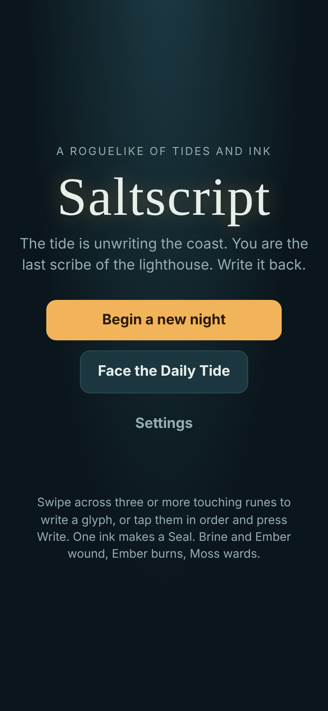
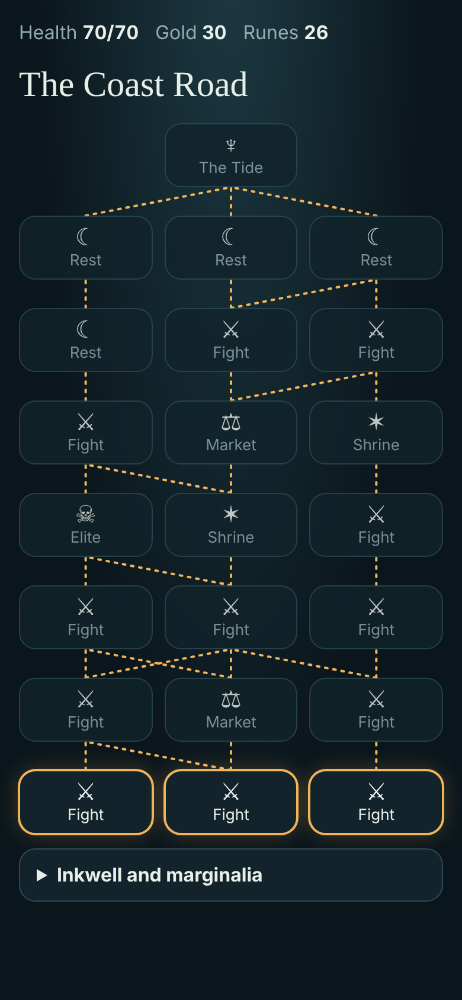
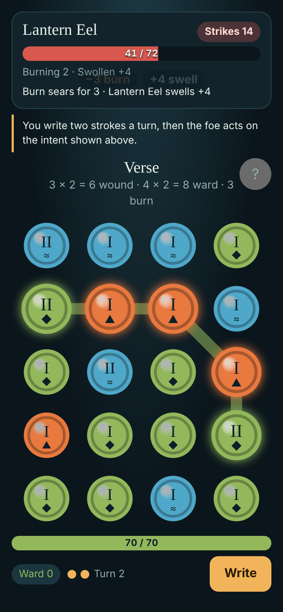
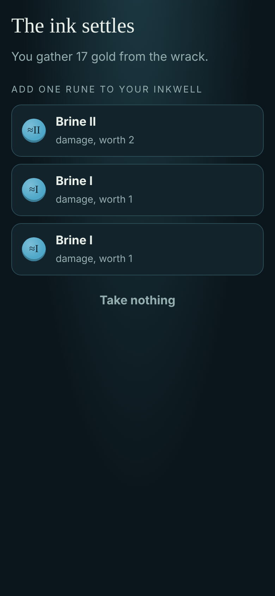

# Saltscript

**A roguelike where every attack is a word you swipe in ink.** The Unwriting Tide is erasing the coast; you are the last scribe of the lighthouse, and you write it back.

<p>
  
  
  
  
</p>

A mobile web roguelike (PWA, portrait, offline) in plain JavaScript, with no build and no runtime dependencies. Every run comes from a seed, and the same deterministic core drives the game, the tests and the balance bots.

## How to play

- Walk the Coast Road: choose a lane each floor through fights, elites, shrines, markets and rests up to the boss of each of three acts
- Swipe across three or more touching runes, in any of eight directions, to write a glyph; or tap them in order and press Write
- A glyph scores chips × mult: chips come from the runes' values, mult from its length (3–4 runes: 1, 5–6: 2, 7+: 3), plus 1 if it uses one ink
- Brine wounds, Ember wounds and sets burning, Moss wards; Salt is left by the Tide, clogs the page and crumbles after three turns
- You write two strokes a turn, then the foe acts on the intent it shows
- After a fight, take gold and add one of three runes to your inkwell; marginalia bend the rules for big combos
- Lamplight banked across runs unlocks marginalia and a new scribe
- **Daily Tide**: the same run for everyone each UTC day, one attempt, and a summary to share

Runs save after every action and resume from the title.

## How to run

```sh
npm install
npm run serve   # http://localhost:5173
```

| Command           | What it does                                                                               |
| ----------------- | ------------------------------------------------------------------------------------------ |
| `npm test`        | Rules, marginalia, shrines, meta, daily, balance bands, sound and PWA tests (`node:test`)  |
| `npm run check`   | Biome lint and format check                                                                |
| `npm run e2e`     | Wins fights by swipes and taps in Chromium, checks reload, offline and axe on every screen |
| `npm run balance` | Plays seeded runs with the bots and prints the [balance table](docs/balance.md)            |

## Layout

- `src/core/` pure, deterministic game logic: run reducer, combat, data, meta, daily, bots
- `src/ui/` board, feedback, routes, sound and saved progress
- `src/main.js` screens and input wiring; `sw.js` offline cache

## More

- [Concept and market read](docs/concept.md)
- [Backlog](BACKLOG.md)
